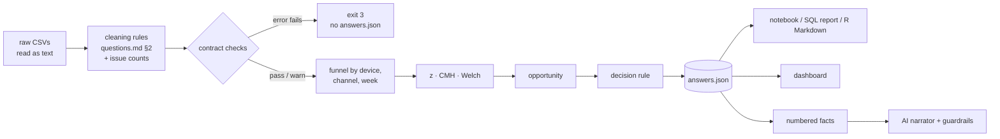

# FunnelLens analysis plan

> Reference version (tag `phase-2-end`), written before any number of the real export was looked at.

## 1. Hypotheses
| | Hypothesis | Supported if | Refuted if |
|---|---|---|---|
| H1 | The mobile checkout loses buyers (Head of Product) | purchase given checkout is lower on mobile **within channels** (CMH p < 0.05, OR < 1) | the adjusted OR's 95 % CI includes 1 |
| H2 | Traffic mix: mobile gets more low-converting channels | the crude gap is larger than the adjusted one; within-channel gaps are small or reversed | within-channel gaps equal the aggregate gap |
| H3 | Mobile buyers spend less per order | Welch's t on order value: mobile mean lower, CI excludes 0 | CI includes 0 |

H1 and H2 are not exclusive: the analysis reports both the crude and the adjusted effect, and says
how much of the gap the mix explains.

## 2. Metrics (definitions in contract/questions.md §3-§5)
- **Unit of analysis:** the clean session. A session *reaches* a step if it has that event; a
  *purchase* is a session with at least one clean order; each step requires the previous one.
- **Step rate** = sessions reaching the step / sessions reaching the previous step (0/0 → null).
- **Conversion** = purchases / sessions. **Revenue** = sum of clean order amounts (paise, integers).
- **Mobile share** of sessions and of revenue (the brief's 69 % vs 61 %).
- **Opportunity** = Σ over channels of mobile checkouts × max(0, desktop rate − mobile rate) at the
  payment step, per month, ÷ sample rate, × mobile average order value.

## 3. Tests
| Q | Test | Assumptions | Reported |
|---|---|---|---|
| Q3 | two-proportion z, pooled SE for the test, unpooled for the CI | independent sessions, n·p ≥ 10 per cell | difference, 95 % CI, z, p |
| Q4 primary | Cochran-Mantel-Haenszel (no continuity correction), strata = channel, only strata where both devices reached the base step | common OR across strata (checked by eye in the per-channel table), independent sessions | MH OR, Robins-Breslow-Greenland 95 % CI, χ², p, crude OR |
| Q4 context | the same for cart given view, plus the Simpson check | as above | within-channel gaps vs aggregate gap |
| Q5 | Welch's t (unequal variances) | independent orders; means are robust at n > 1000 despite skew | difference, Welch-Satterthwaite df, 95 % CI, p |

One primary test (Q4, purchase given checkout). Everything else is descriptive and cannot overturn
the decision rule on its own.

## 4. Pipeline

## 5. What would change the decision
| Result of the primary test | Uplift | Recommendation |
|---|---|---|
| p ≥ 0.05 | — | do not rebuild; look elsewhere (traffic mix, pricing) |
| p < 0.05, OR < 1 | ≥ ₹25 lakh / month | rebuild the checkout |
| p < 0.05, OR < 1 | < ₹25 lakh / month | targeted experiment on the payment step |

A significant result with OR > 1 (mobile *better*) also means "do not rebuild".

## 6. Threats to validity
- **Internal:** confounders other than channel (intent, income, app vs mobile web); measurement
  (events lost by tracking, orders without checkout); the 6-month window may include seasonal mix
  shifts (checked with the weekly series).
- **External:** one country, one store, one half-year; the sample is random, so rates generalise to
  the full traffic of the period, not to the future.
- **Statement in the memo:** the evidence is observational; the recommendation is a decision under
  uncertainty, and an experiment is the way to establish cause.
